&nbsp;
&nbsp;
&nbsp;
&nbsp;

 

<table width="100%">
<tr>
<td width="64%" valign="top">

ABOUT · URMIA, IRAN · REMOTE WORLDWIDE

I founded and lead **[TECSO](https://github.com/Tecso-Dev)** (راهکارپرداز فن‌آوران هوشمند), a software and infrastructure studio building products since 2018. My day-to-day: **Go** and **Python (FastAPI)** back-ends, **Vue / Nuxt** and **React** front-ends, PostgreSQL and Redis, Docker and Kubernetes, plus the evals, guards and CI/CD that keep AI features reliable in production.

</td>
<td width="36%" valign="top">

RIGHT NOW

- **BOBRES** · Telegram sales bot, Mini App and panel
- **SorinFlow** · scaling the real-estate CRM
- **NOXIOAI** · building AI staff for SMBs
- **KhodroBin** · tuning ranking and guards

🟢 Open to select remote roles and contracts

</td>
</tr>
</table>

<table width="100%">
<tr>
<td width="33%" valign="top">ROLE FIT<h4>AI product engineering</h4>
LLM systems, agents with approval gates, full-stack Go / TypeScript / Python.
</td>
<td width="33%" valign="top">PROOF<h4>Products in use</h4>
SorinFlow, NOXIOAI and KhodroBin are built and run by my team, from data pipeline to deploy.
</td>
<td width="33%" valign="top">CREDENTIALS<h4>BSc + C2 English</h4>
Computer Engineering, University of Tabriz. English C2 (<a href="https://cert.efset.org/en/odLaRd">EF SET 76/100</a>), native Persian.
</td>
</tr>
</table>

## What I'm building right now

## Selected work

<table width="100%">
<tr>
<td width="50%" valign="top">
MARKETPLACE SEARCH · OPEN SOURCE
<h3><a href="https://github.com/sobhanaz/khodrobin">KhodroBin</a></h3>

Multi-source used-car price engine: 5 crawlers, one car resolved across listings, sub-millisecond ranking and a five-axis hallucination guard on every LLM explanation. 268 tests gate each deploy.

<code>Go</code> <code>FastAPI</code> <code>Nuxt 3</code> <code>PostgreSQL</code> <code>Ollama</code>
</td>
<td width="50%" valign="top">
REAL ESTATE · <a href="https://sorinflow.com">sorinflow.com ↗</a>
<h3><a href="https://github.com/Tecso-Dev/SorinFlow-DaTA-mAmager">SorinFlow</a></h3>

Divar scraper plus Persian CRM: 189 endpoints, RBAC, SMS and email panels, 6 AI agents, 775 tests and a k3s deploy with auto-rollback and encrypted off-site backups.

<code>FastAPI</code> <code>Playwright</code> <code>PostgreSQL</code> <code>k3s</code>
</td>
</tr>
<tr>
<td width="50%" valign="top">
AI SAAS · <a href="https://noxioai.com">noxioai.com ↗</a>
<h3><a href="https://noxioai.com">NOXIOAI</a></h3>

Multi-tenant AI customer-response SaaS with a 24/7 Go agent pipeline (JARVIS) that works behind human approval gates.

<code>Go</code> <code>Nuxt 3</code> <code>PostgreSQL</code> <code>LLM APIs</code>
</td>
<td width="50%" valign="top">
PHYSICAL SECURITY · <a href="https://sobhanaz.github.io/Gardian-One/">docs ↗</a>
<h3><a href="https://github.com/sobhanaz/Gardian-One">Guardian One</a></h3>

Architecture and documentation for an on-premise, AI-augmented security platform: face recognition, access control, RTLS and an audit trail.

<code>Go</code> <code>Computer vision</code> <code>NATS</code> <code>React</code> <code>Flutter</code>
</td>
</tr>
</table>

More in <a href="https://github.com/sobhanaz?tab=repositories">my repositories</a> and the <a href="https://github.com/Tecso-Dev">TECSO organization</a>.

## Technical toolkit

<table width="100%">
<tr><td width="22%">LANGUAGES</td><td></td></tr>
<tr><td>FRONT-END</td><td></td></tr>
<tr><td>BACK-END & DATA</td><td></td></tr>
<tr><td>DEVOPS & TOOLS</td><td></td></tr>
</table>

Also: network infrastructure (Cisco, MikroTik, Juniper), Linux hardening, test-gated CI/CD, encrypted backups and monitoring.

## Experience

<table width="100%">
<tr><td width="20%" valign="top"><b>2018 – now</b></td><td valign="top"><b>Founder & Technical Lead · TECSO</b> End-to-end delivery of web, AI and infrastructure projects for Iranian businesses. The products above are built and run by this team.</td></tr>
<tr><td valign="top"><b>2024 – 2025</b></td><td valign="top"><b>IT & Communications · Red Crescent Society, West Azerbaijan</b> Designed and deployed multi-branch network infrastructure (Cisco, MikroTik, Juniper, HP ProLiant) for disaster-response operations.</td></tr>
<tr><td valign="top"><b>2022 – 2024</b></td><td valign="top"><b>COO & Head of Engineering · Saxtiran</b> Go microservices, Vue front-end, Flutter app, Kubernetes, Prometheus and Grafana.</td></tr>
<tr><td valign="top"><b>Education</b></td><td valign="top"><b>BSc Computer Engineering · University of Tabriz</b></td></tr>
</table>

## Contribution city

## Work with me

<table width="100%">
<tr>
<td width="50%" valign="top">
COMPANIES IN IRAN
<h4>Projects and partnerships through TECSO</h4>

Enterprise software and automation, AI on your own data, DevOps and servers, network design, UI/UX and technical proposals. Remote-first, on-site for key milestones. <a href="https://github.com/Tecso-Dev">See the TECSO page →</a>

</td>
<td width="50%" valign="top">
REMOTE ROLES
<h4>AI product engineering, LLM systems, full-stack</h4>

Open to select remote roles and contracts where I can own a feature from data pipeline to production.

</td>
</tr>
</table>

**برای شرکت‌ها و همکاران در ایران:** راهکارپرداز فن‌آوران هوشمند (TECSO) پروژه‌های نرم‌افزار سازمانی و اتوماسیون، هوش مصنوعی روی داده‌های سازمان، DevOps و سرور، طراحی و پیکربندی شبکه، UI/UX و تدوین اسناد فنی را به‌صورت پروژه‌ای و دورکاری انجام می‌دهد.

 

&nbsp;
&nbsp;

3D cards rebuilt from live GitHub data every 6 hours · language card by <a href="https://www.gitskins.com">GitSkins</a>

